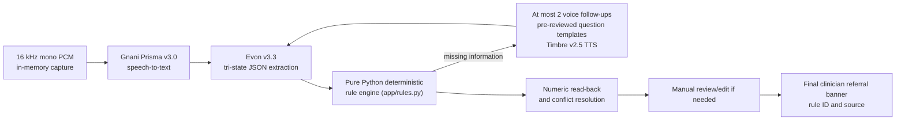

# ASHA ANC Home-Visit Copilot

> **Clinical safety disclaimer:** **Record-Keeping and Deterministic MoHFW/PMSMA Guideline Flagging Only. Never Diagnoses, Recommends Treatment, or Assigns PMSMA Stickers.**

[](https://asha-anc-copilot.onrender.com)
[](https://github.com/Wrathemperor/ASHA-ANC-Copilot)
[](assets/demo.mp4)
[](#run-the-tests)

A voice-first, browser-based clinical record-keeping copilot that helps Accredited Social Health Activists (ASHA workers) document antenatal care (ANC) home visits, catch missing danger signs, and surface deterministic clinician-referral flags in Indic languages.

---

## Project Demonstration Video


https://github.com/user-attachments/assets/698eedc9-2e99-4853-b094-870ae3f15ca3


<p align="center">
  <a href="https://github.com/Wrathemperor/ASHA-ANC-Copilot/raw/main/assets/demo.mp4">
    
  </a>
</p>

<p align="center">
  <video src="https://github.com/Wrathemperor/ASHA-ANC-Copilot/raw/main/assets/demo.mp4" controls width="100%" style="max-width: 820px;">
    <a href="https://github.com/Wrathemperor/ASHA-ANC-Copilot/raw/main/assets/demo.mp4">Click here to play or download the demo video directly (assets/demo.mp4)</a>
  </video>
</p>

https://github.com/Wrathemperor/ASHA-ANC-Copilot/raw/main/assets/demo.mp4

> [!TIP]
> - **Direct Stream / Download:** [`assets/demo.mp4`](assets/demo.mp4)
> - **Live Web Application:** [https://asha-anc-copilot.onrender.com](https://asha-anc-copilot.onrender.com)
> - *Note on GitHub Inline Video:* GitHub's markdown parser converts video links into its native in-page player when the video is uploaded through GitHub's web interface (drag and drop `demo.mp4` into the README editor or an Issue comment on `github.com`).

---

## Solution Pitch and Summary (1-Page Brief)

### 1. Operational Context
India has over 900,000 Accredited Social Health Activists (ASHAs) serving as the frontline link between expectant mothers and primary health centers. During antenatal care (ANC) home visits, an ASHA worker must record maternal vitals, screen for obstetric danger signs, and ensure timely hospital referrals.

Today, this data is hand-written across paper registers while moving door-to-door in noisy rural environments. Crucial complications such as pre-eclampsia, gestational hypertension, severe anemia, and reduced fetal movement are often documented inconsistently or recognized too late for preventive clinical intervention.

### 2. The Danger of Generic Conversational AI in Clinical Care
Deploying standard generative chatbots directly to frontline community health workers introduces severe safety failure modes:
- **Silent assumptions:** When a worker forgets to mention a symptom (for example, whether the mother has a headache), conversational LLMs frequently default that omission to "absent" or "normal." In obstetric care, unmentioned data is unknown data, not negative data.
- **Diagnostic hallucination:** General-purpose language models often attempt to diagnose conditions, prescribe drugs, or generate false reassurance without clinical grounds.
- **Vernacular failure:** Frontline speech is heavily code-mixed (regional mother tongue blended with English clinical loanwords like "BP", "tablets", or "weeks"). Generic speech engines produce high word error rates on Indian accents and dialects.

### 3. The Copilot Solution
The ASHA ANC Home-Visit Copilot replaces open-ended chatting with a strictly bounded voice pipeline:

```
Frontline Speech (hi-IN, mr-IN, te-IN, ta-IN, ml-IN, en-IN)
   │
   ▼
Gnani Prisma v3.0 (Indic Speech-to-Text via https://api.vachana.ai/stt/v3)
   │
   ▼
Gemini 2.5 Flash / Evon v3.3 (Constrained Fact Extraction into Tri-State JSON)
   │
   ▼
Deterministic Python Rule Engine (MoHFW & PMSMA Clinical Rules)
   ├─► Immediate Emergency Bypass (Convulsions, Hemorrhage, Severe Pain -> URGENT_REFERRAL)
   ├─► Pre-Eclampsia Gap Priority (High BP or Edema prioritizes headache/vision questions)
   └─► Max 2 Spoken Follow-Ups via Gnani Timbre v2.5 TTS (Fixed Reviewed Templates)
   │
   ▼
Spoken Read-Back & Conflict Resolution -> Final Verified Clinical Referral Banner
```

### 4. Technical Architecture and Safety Guarantees

1. **Indic Speech Recognition with Gnani Prisma v3.0:**
   The ASHA worker speaks naturally in Hindi, Marathi, Telugu, Tamil, Malayalam, or Indian English. The audio is captured in browser memory as 16 kHz mono PCM and transcribed by Gnani Prisma v3.0 using Indian clinical vocabulary hints.

2. **Strict Tri-State Fact Extraction:**
   The extraction layer maps spoken transcripts into an explicit schema where every clinical symptom is strictly `present`, `denied`, or `not_mentioned`. Silence remains `not_mentioned` and is surfaced as an open data gap. Every finding requires an exact verbatim evidence span from the transcript. The model is barred from assigning referral categories.

3. **Deterministic MoHFW / PMSMA Rule Evaluation:**
   Referral logic is executed entirely in pure Python ([`app/rules.py`](app/rules.py)) against Ministry of Health and Family Welfare (MoHFW) guidelines:
   - **Emergency Bypass (`RULE-EMG-01` to `04`):** Vaginal bleeding, convulsions, severe headache with blurred vision, or severe abdominal pain immediately halt follow-up turns and trigger an immediate urgent referral alert.
   - **Pre-Eclampsia Prioritization:** A blood pressure at or above 140/90 mmHg or visible swelling automatically promotes headache and vision questions to the top of the inquiry queue.
   - **Gestational Stage Gate (`STAGE-GATE-01`):** Fetal movement is only required after 20 weeks gestation, preventing false alarms in early pregnancy.

4. **Reviewed Spoken Follow-Ups with Gnani Timbre v2.5:**
   When required safety fields are missing, the system synthesizes targeted voice questions in the worker's selected language using Gnani Timbre v2.5 TTS. Questions are selected exclusively from a pre-reviewed catalog ([`app/templates/questions.json`](app/templates/questions.json)). The model cannot invent novel medical questions. Follow-up turns are capped at two.

5. **Spoken Read-Back and Conflict Resolution:**
   The system reads back extracted numerical values (blood pressure and gestational weeks) for verbal or manual confirmation. Conflicting entries cannot overwrite earlier verified records without explicit confirmation.

6. **Privacy and Compliance:**
   Voice audio is processed in volatile memory. No patient audio files or voice biometric prints are persisted to disk or external databases.

### 5. Verification and Deliverables
- **Offline Test Suite:** 70 unit and integration tests passing (`pytest -q`), verifying extraction schema boundaries, negation handling, noise resistance (clean, 15 dB SNR, 5 dB SNR), and offline fallback.
- **Zero Hallucination Referrals:** 100% of referral decisions are produced by rule functions with exact source citations.
- **Live Deployment:** Production service hosted on Render at `https://asha-anc-copilot.onrender.com`.

---

## Problem and solution

ASHA workers often record antenatal home visits in paper registers while moving between households, in noisy environments, and in the language they speak most comfortably. The copilot supports code-mixed speech and language selection for Hindi (`hi-IN`), Marathi (`mr-IN`), Telugu (`te-IN`), Tamil (`ta-IN`), Malayalam (`ml-IN`), and Indian English (`en-IN`).

A conventional chatbot can turn an unmentioned symptom into an assumed normal finding. That is unsafe in a clinical record. This app instead uses explicit tri-state values, source-backed deterministic rules, fixed reviewed follow-up questions, and a human-reviewed read-back/edit step. Silence remains unknown and visible.

## Architecture and session flow



Audio is handled in memory by the app; the application does not persist visit recordings. Prisma performs transcription, Evon extracts fields into a validated schema, and all rule evaluation is deterministic Python. The model does not choose referral flags. Fixed translated question text comes from [`app/templates/questions.json`](app/templates/questions.json); hosted Timbre audio for fixed templates is SHA-256 cached on disk.
Hosted Evon is called over its OpenAI-compatible cloud API. This project does not download Hugging Face model weights or install GPU inference libraries.

The browser accepts microphone recording and `.mp3` / `.wav` uploads. Uploaded files are decoded and converted to 16 kHz mono PCM WAV in browser memory before submission. With `DEMO_OFFLINE_MODE=1`, no recording is sent to a service: the audio bytes deterministically select a synthetic scenario transcript, Evon output is fixture-backed, and Timbre returns a short WAV tone while the actual prompt stays visible as text. Offline mode is a UI/demo path only, not speech recognition or clinical extraction; never use patient recordings in it.

## Clinical safety guardrails

- **Tri-state schema:** each clinical symptom is `present`, `denied`, or `not_mentioned`. Only explicit statements support `present` or `denied`; silence never defaults to denied.
- **20-week fetal-movement stage gate (`STAGE-GATE-01`):** reduced fetal movement is required at 20 weeks or later. Before 20 weeks, it is not raised as a missing gap. If gestational weeks are unknown, the field remains required.
- **Immediate emergency bypass (`RULE-EMG-01`–`04`):** convulsions, vaginal bleeding, severe headache together with blurred vision, or severe abdominal pain immediately halt routine follow-ups and trigger `URGENT_REFERRAL`.
- **Other high-risk flags:** `RULE-HRP-01` flags a recorded BP with systolic at least 140 and diastolic at least 90; `RULE-HRP-02` through `05` cover headache/vision, swelling, reduced fetal movement, and anemia/low Hb, fever, or leaking fluid. Leaking fluid is a high-risk rule in this ruleset, **not** an emergency bypass rule.
- **Pre-eclampsia-related gap priority:** with recorded BP at or above 140/90 or swelling present, unmentioned `severe_headache` and `blurred_vision` are promoted to the top of the follow-up order.
- **Safe Turn 2 merging:** Turn 2 can fill fields that were unknown in Turn 1. It cannot silently replace a Turn 1 value; differing values are captured for read-back conflict review.
- **Capped follow-ups:** no more than two voice follow-ups. Remaining unknown mandatory fields stay visible as incomplete / needs verification.
- **Pre-reviewed questions only:** question text is loaded from the reviewed templates; the app does not invent clinical questions.
- **Human review:** numeric read-back permits one voice correction, then uses manual edit rather than looping. No treatment recommendation or PMSMA sticker assignment is produced.

The rule IDs and citations are maintained in [`docs/official_rules.md`](docs/official_rules.md).

## Evaluation harness and benchmark results

The checked-in harness has 20 synthetic multilingual scenarios replayed under clean, 15 dB SNR, and 5 dB SNR conditions (60 scenario/noise observations). Critical extraction errors are reported separately as **False Reassurance** and **False Alarm**. The report below is the deterministic `--dry-run` fixture baseline: fixture transcripts and simulated latencies are used. **These results are not live acoustic measurements or measured service latency.** Zero dry-run WER/CER is expected because the fixture transcript is replayed rather than independently transcribed.

### Overall metrics

| Metric | Raw count | Rate | Notes |
|---|---:|---:|---|
| 1. Critical Extraction Errors — False Reassurance | 0 of 21 | 0.0% | |
| 1. Critical Extraction Errors — False Alarm | 0 of 357 | 0.0% | |
| 2. Danger-Sign Flag Recall | 24 of 24 | 100.0% | |
| 3. Gap-Check Correctness / Priority Order | 12 of 12 | 100.0% | |
| 4. Read-Back Catch Rate — Injected Errors | 6 of 6 | 100.0% | |
| 5. Transcription Quality — WER | 0 of 1326 | 0.0% | 0 word edits |
| 5. Transcription Quality — CER | 0 of 8157 | 0.0% | 0 character edits |
| 6. Per-Turn Latency Breakdown | 60 turns | n/a | Mean Prisma 451.83 ms; Evon 601.60 ms; rules 1.97 ms; Timbre 335.72 ms; total turn 1.39 s |

### Language and noise breakdown

| Language | Noise | Extraction fields | Extraction accuracy | Rule match | WER | CER | Danger recall | Gap order | Read-back catch | Mean turn latency (s) |
|---|---|---:|---:|---:|---:|---:|---:|---:|---:|---:|
| en-IN | 15dB | 28 of 28 | 100.0% | 100.0% | 0.0% | 0.0% | 1 of 1 | 0 of 0 | 0 of 0 | 1.410 |
| en-IN | 5dB | 28 of 28 | 100.0% | 100.0% | 0.0% | 0.0% | 1 of 1 | 0 of 0 | 0 of 0 | 1.460 |
| en-IN | clean | 28 of 28 | 100.0% | 100.0% | 0.0% | 0.0% | 1 of 1 | 0 of 0 | 0 of 0 | 1.226 |
| hi-IN | 15dB | 41 of 41 | 100.0% | 100.0% | 0.0% | 0.0% | 3 of 3 | 1 of 1 | 1 of 1 | 1.345 |
| hi-IN | 5dB | 41 of 41 | 100.0% | 100.0% | 0.0% | 0.0% | 3 of 3 | 1 of 1 | 1 of 1 | 1.512 |
| hi-IN | clean | 41 of 41 | 100.0% | 100.0% | 0.0% | 0.0% | 3 of 3 | 1 of 1 | 1 of 1 | 1.316 |
| ml-IN | 15dB | 20 of 20 | 100.0% | 100.0% | 0.0% | 0.0% | 1 of 1 | 0 of 0 | 0 of 0 | 1.404 |
| ml-IN | 5dB | 20 of 20 | 100.0% | 100.0% | 0.0% | 0.0% | 1 of 1 | 0 of 0 | 0 of 0 | 1.568 |
| ml-IN | clean | 20 of 20 | 100.0% | 100.0% | 0.0% | 0.0% | 1 of 1 | 0 of 0 | 0 of 0 | 1.262 |
| mr-IN | 15dB | 32 of 32 | 100.0% | 100.0% | 0.0% | 0.0% | 1 of 1 | 2 of 2 | 0 of 0 | 1.409 |
| mr-IN | 5dB | 32 of 32 | 100.0% | 100.0% | 0.0% | 0.0% | 1 of 1 | 2 of 2 | 0 of 0 | 1.451 |
| mr-IN | clean | 32 of 32 | 100.0% | 100.0% | 0.0% | 0.0% | 1 of 1 | 2 of 2 | 0 of 0 | 1.315 |
| ta-IN | 15dB | 31 of 31 | 100.0% | 100.0% | 0.0% | 0.0% | 1 of 1 | 0 of 0 | 1 of 1 | 1.418 |
| ta-IN | 5dB | 31 of 31 | 100.0% | 100.0% | 0.0% | 0.0% | 1 of 1 | 0 of 0 | 1 of 1 | 1.515 |
| ta-IN | clean | 31 of 31 | 100.0% | 100.0% | 0.0% | 0.0% | 1 of 1 | 0 of 0 | 1 of 1 | 1.276 |
| te-IN | 15dB | 27 of 27 | 100.0% | 100.0% | 0.0% | 0.0% | 1 of 1 | 1 of 1 | 0 of 0 | 1.409 |
| te-IN | 5dB | 27 of 27 | 100.0% | 100.0% | 0.0% | 0.0% | 1 of 1 | 1 of 1 | 0 of 0 | 1.465 |
| te-IN | clean | 27 of 27 | 100.0% | 100.0% | 0.0% | 0.0% | 1 of 1 | 1 of 1 | 0 of 0 | 1.298 |


## Quickstart

### Requirements and environment

Python 3.11 is the project target. In PowerShell, create and activate a virtual environment and install dependencies:

```powershell
py -3.11 -m venv .venv
.\.venv\Scripts\Activate.ps1
python -m pip install --upgrade pip
python -m pip install -r requirements.txt
```

Prisma and Timbre use the Gnani SDK when it is installed, and otherwise call Gnani's documented REST endpoints directly with `httpx`. The SDK is optional; no private wheel or package index is required for the REST path.

Copy `.env.example` to `.env` as a configuration checklist and provide:

```dotenv
GNANI_API_KEY=your_account_key
EVON_BASE_URL=your_Evon_base_URL
EVON_MODEL=gnani/gnani-evon-v3.3-30B-A3B
DEMO_OFFLINE_MODE=0
```

`EVON_API_KEY` is optional and falls back to `GNANI_API_KEY`. The app loads `.env` with `python-dotenv`; process environment variables take precedence. For local, zero-credit fixture demos, set `DEMO_OFFLINE_MODE=1` in `.env` and restart the app. Set it to `0` for hosted API mode. Offline mode must be explicitly enabled and does not silently replace a failed live call. Never commit credentials.

To manually verify hosted API access, run the credit-guarded script from the repository root. It prompts before making requests; Prisma is only tested when a sample WAV is supplied. These calls may consume API credits:

```powershell
.\.venv\Scripts\python.exe scripts\verify_api_key.py
.\.venv\Scripts\python.exe scripts\verify_api_key.py --test-stt eval\audio\sample.wav
```

### Run the tests

```powershell
.\.venv\Scripts\python.exe -m pytest -q
```

The offline test suite passes **63 tests**. It exercises mocked Gnani clients and explicit fixture mode; it does not require live credentials or download model weights.

### Start the local app

```powershell
.\.venv\Scripts\python.exe -m uvicorn app.main:app --host 127.0.0.1 --port 8000
```

Open [http://127.0.0.1:8000/](http://127.0.0.1:8000/). In hosted mode, Prisma/Timbre use the authorized Gnani SDK if installed or the documented REST endpoints otherwise; Evon uses the configured OpenAI-compatible cloud endpoint. Valid credentials and network access are required, and requests may incur API credits. In offline demo mode, the page displays a prominent synthetic-fixture notice.

### Run evaluation

Offline, deterministic fixture run (zero API credits):

```powershell
.\.venv\Scripts\python.exe -m eval.run_eval --dry-run --lang all --noise all
```

Explicit live evaluation (uses matching `eval/audio/{scenario_id}.wav` clips; read-back cases also require `{scenario_id}_readback.wav`; may incur API credits):

```powershell
.\.venv\Scripts\python.exe -m eval.run_eval --live --lang all --noise all
```

Live responses are cached under `.cache/eval_cache/`. Cache hits avoid repeating an already evaluated Prisma/Evon response. Do not run live evaluation without confirming the available recordings, account authorization, and credit budget.

### Run the single-clip live spike

Live hosted API mode:

```powershell
.\.venv\Scripts\python.exe -m scripts.live_spike "eval/audio/Test 1 - hindi.wav" --language hi-IN
```

This can incur API credits. For a local fixture-backed smoke test instead, set `DEMO_OFFLINE_MODE=1` in `.env`, restart the terminal, then run the same command. Offline mode does not recognize speech; it selects a fixture transcript deterministically from the audio bytes and outputs a local WAV tone.

## Project documentation

- Product requirements: [`docs/PRD.md`](docs/PRD.md)
- Official rule IDs and source citations: [`docs/official_rules.md`](docs/official_rules.md)
- Gnani API and SDK notes: [`docs/gnani_api_notes.md`](docs/gnani_api_notes.md)
- Synthetic scenario scripts: [`eval/recording_scripts.md`](eval/recording_scripts.md)
- Development progress: [`docs/PROGRESS.md`](docs/PROGRESS.md)
